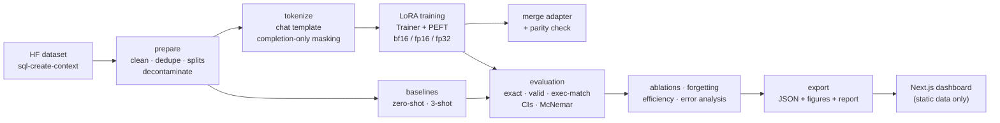

# LLM Fine-Tuning & Evaluation Pipeline (`llm-finetune-eval`)

An end-to-end, honest pipeline for fine-tuning an open-weight language model with **LoRA
(PEFT)** and evaluating it rigorously against its own baselines. The demo task is
**text-to-SQL**: given `CREATE TABLE` statements and a natural-language question, generate
a SQL query.

Everything that needs compute runs **locally or on a GPU notebook** and writes static
JSON/PNG artifacts. The dashboard (`web/`, Next.js on Vercel) only renders those files —
no model inference, no secrets, no server-side training.

- **Task:** text-to-SQL on [`b-mc2/sql-create-context`](https://huggingface.co/datasets/b-mc2/sql-create-context)
- **Models (ungated):** `HuggingFaceTB/SmolLM2-135M-Instruct` (CPU profile) and
  `Qwen/Qwen2.5-0.5B-Instruct` (GPU profile)
- **Method:** `transformers.Trainer` + `peft`, hand-written prompt formatting and collator,
  completion-only loss masking, dynamic padding, cosine schedule with warmup
- **Evaluation:** normalized exact match, SQL validity, **execution match** on synthetic
  seeded SQLite databases, bootstrap CIs, paired McNemar tests, ablations, forgetting
  checks, failure taxonomy

## Architecture



## Quick start

```bash
make setup                 # python venv + pinned deps + web deps
make test                  # pytest (CPU unit tests, < 3 min)
make lint                  # ruff

# full pipeline for the detected profile
make all PROFILE=cpu       # or PROFILE=gpu on a CUDA box

# dashboard
make web-dev               # http://localhost:3000
make web-build
```

Or with the CLI directly:

```bash
python -m mlfte.cli prepare   --profile cpu
python -m mlfte.cli baseline  --profile cpu
python -m mlfte.cli train     --profile cpu
python -m mlfte.cli eval      --profile cpu
python -m mlfte.cli ablate    --profile cpu
python -m mlfte.cli efficiency --profile cpu
python -m mlfte.cli analyze   --profile cpu
python -m mlfte.cli export    --profile cpu
python -m mlfte.cli ingest results.zip --expect-profile gpu
```

Every command accepts `--profile {cpu,gpu,smoke}`, `--config path.yaml`,
`--override training.learning_rate=1e-4` and `--force`.

## Hardware and mixed precision

Hardware is detected (`cuda > mps > cpu`) and never assumed. The precision policy is a pure
function of `(device, bf16_supported)`:

| Device | Precision | GradScaler | Notes |
| --- | --- | --- | --- |
| CUDA with bf16 | bf16 autocast | no | bf16 has fp32-range exponents |
| CUDA without bf16 (T4) | fp16 autocast | yes | LoRA trainable params cast to fp32 to avoid FP16 unscale errors |
| MPS | fp32 | no | recorded as "mixed precision: not used" |
| CPU | fp32 | no | recorded as "mixed precision: not used" |

Exact device, precision, GPU name, VRAM, torch/transformers/peft versions, git hash and data
fingerprint are written into every result file and shown in the dashboard badge.

## Config reference

| Section | Key fields |
| --- | --- |
| `run` | `seed`, `train_seeds`, `tag` |
| `model` | `name`, `max_seq_len`, `load_dtype` |
| `data` | `dataset`, `train_size`, `val_size`, `test_size`, length filters |
| `lora` | `r`, `alpha`, `dropout`, `target_modules` (`auto` / `attention` / `all_linear` / list) |
| `training` | batch size, grad accumulation, `learning_rate`, `warmup_ratio`, `lr_scheduler_type`, `max_grad_norm`, `gradient_checkpointing`, `max_steps`, `loss_masking` |
| `eval` | `max_new_tokens`, `batch_size`, `bootstrap_resamples`, `exec_timeout_s`, `few_shot_k`, `arc_subset`, `wikitext_slice` |
| `efficiency` | `latency_repeats`, `batch_size` |

## Running the GPU profile on Colab / Kaggle

1. Open `notebooks/run_on_colab.ipynb` in Colab (runtime → GPU).
2. It clones the repo, installs pinned deps, runs `mlfte all --profile gpu`, then zips
   `results/export/` and the figures.
3. Download the zip, then install it locally:

```bash
python -m mlfte.cli ingest results-gpu.zip --expect-profile gpu
```

`ingest` validates every JSON file against the schema, verifies that `env.json` really
reports the claimed profile/hardware (a `gpu` claim without a CUDA device is rejected), then
replaces the dashboard data and regenerates the tables below.

## Results

_Every number below is generated from real runs by `mlfte export`; the profile and hardware
are stated in the block. Numbers are never hand-edited._

<!-- RESULTS:START -->

**Active profile:** `smoke` · device=`cpu` · profile=`smoke` · cpu=8 vCPU · ram=15.82 GB · precision=`fp32` · model `HuggingFaceTB/SmolLM2-135M-Instruct` · data fingerprint `5b252f05b727`

### Before / after on the held-out test split

Test n=24 · values are mean with 95% bootstrap CIs

| Run | Exact match | SQL valid | Execution match |
| --- | --- | --- | --- |
| `base_zero_shot` | 0.0% [0.0, 0.0] | 70.8% [50.0, 87.5] | 20.8% [8.3, 37.5] |
| `base_few_shot` | 12.5% [0.0, 29.2] | 58.3% [37.5, 79.2] | 20.8% [8.2, 37.5] |
| `finetuned_adapter` | 0.0% [0.0, 0.0] | 62.5% [45.7, 79.2] | 8.3% [0.0, 20.8] |
| `finetuned_merged` | 0.0% [0.0, 0.0] | 62.5% [45.7, 79.2] | 8.3% [0.0, 20.8] |

**Paired significance (McNemar) on execution match**

| Comparison | Δ absolute | Δ relative | p-value | Significant (0.05) |
| --- | --- | --- | --- | --- |
| finetuned_adapter vs base_zero_shot | -12.50 pp | -60.0% | 0.2500 | no |
| finetuned_adapter vs base_few_shot | -12.50 pp | -60.0% | 0.3750 | no |
| finetuned_merged vs base_zero_shot | -12.50 pp | -60.0% | 0.2500 | no |
| finetuned_merged vs base_few_shot | -12.50 pp | -60.0% | 0.3750 | no |

**Training seeds:** 1 seed(s) — execution match 8.3% ± 0.0% (mean ± std). 1 completed training seed(s). The CPU budget only allowed a single seed; seed variance is not estimated.

### Training

- Steps: **8** · epochs completed: 0.5 · wall clock: 19.8 s
- Trainable params: **1,221,120** (0.900% of 135,736,128)
- Precision: `fp32` — mixed precision: not used (CPU device: no fp16/bf16 training benefit).
- Throughput: 114.6 tokens/s (estimated) · peak RSS 1653.4 MB

### Forgetting checks

| Check | Before | After | Δ | Direction |
| --- | --- | --- | --- | --- |
| WikiText-2 perplexity (↓ better) | 25.181 | 25.137 | -0.044 | improved |
| ARC-Easy accuracy (↑ better, n=8) | 62.5% | 62.5% | +0.00 pp | improved |

### Efficiency

| Model | p50 latency | p95 latency | tokens/s |
| --- | --- | --- | --- |
| `base` | 1734.83 ms | 1815.91 ms | 18.32 |
| `adapter_unmerged` | 2072.95 ms | 2162.67 ms | 15.35 |
| `merged` | 1754.78 ms | 1819.44 ms | 18.2 |

Adapter size: **25.823 MB** · trained params 0.000% of 135,736,128

Mixed precision: **mixed precision: not measured (device=cpu; no CUDA device available, so fp32 vs bf16/fp16 cannot be compared and is not simulated).**

<!-- RESULTS:END -->


## Limitations

- **One task, one dataset.** Text-to-SQL over `sql-create-context`; no generality claims.
- **Execution match is approximate.** It runs gold and predicted SQL on *synthetic seeded*
  SQLite tables, not the original databases. False equivalences and false mismatches are
  both possible; aggregate/JOIN-heavy queries are weakly discriminative.
- **Small models.** SmolLM2-135M and Qwen2.5-0.5B are tiny; absolute accuracy is low by
  design and a fine-tune may move only a few points.
- **Subset training.** The CPU profile trains on a 1,200-example subset, not the full 78k
  rows, to fit the time budget of a 2 vCPU machine.
- **Few-shot baseline.** 3 exemplars chosen once from train (one per complexity bucket) and
  reused everywhere, so the few-shot number is not tuned.
- **Single seed on CPU.** Seed variance is not estimated unless the budget allows ≥ 3 seeds.

## Project structure

```
configs/              cpu · gpu · smoke · ablations
src/mlfte/
  config.py seed.py device.py env_info.py logging_utils.py
  tasks/              base.py text2sql.py            # pluggable task interface
  data/               prepare.py decontam.py tokenize.py collator.py
  training/           lora.py train.py merge.py
  evaluation/         generate.py sql_exec.py metrics.py stats.py
                      general.py efficiency.py error_analysis.py
  export/             web_artifacts.py ingest.py
  report.py figures.py cli.py
tests/                95 CPU tests (no real training)
notebooks/            run_on_colab.ipynb (generated)
figures/              committed 200-dpi PNGs
web/                  Next.js dashboard (static data)
results/              gitignored raw outputs
```

## Reproducibility

- Fixed split seed (`1234`), fixed few-shot seed (`7777`), seeded training.
- Decontamination: normalized `sha256(question+schema)` must be unique across splits, plus a
  5-gram shingle Jaccard ≥ 0.9 near-duplicate check.
- The test split is never used for training, model selection or early stopping.
- `data_fingerprint` (sha256 over the split files) and `git_commit` are embedded in every
  result artifact, so a number can always be traced to code + data.

## License

MIT — see [LICENSE](LICENSE). Dataset: CC-BY-4.0 (`b-mc2/sql-create-context`). Models:
Apache-2.0 (`SmolLM2-135M-Instruct`, `Qwen2.5-0.5B-Instruct`).
